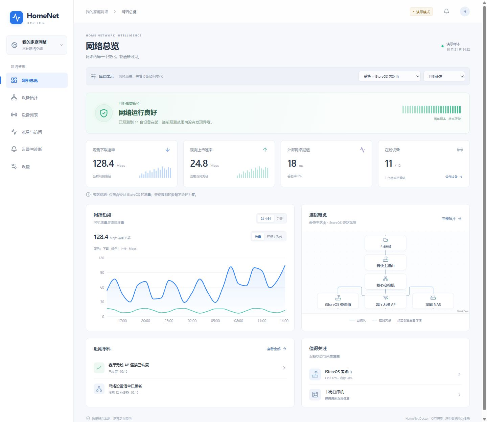

# HomeNet Doctor

面向 iStoreOS / OpenWrt 的中文家庭网络观察界面，采用 UniFi 风格浅色设计，支持电脑与手机。

## v0.3.1 真实采集测试版

Go 后台独立采集本机资源、邻居、ARP 发现、mDNS / HostHints 和有界 ICMP 探测。SQLite 保存接口趋势、设备状态事件与 nlbwmon 可见路径的按设备增量流量；关闭页面不影响采集。关键设备默认 10 秒调度，普通设备目标 60 秒，ARP 与服务发现 5 分钟；并发 4、最多 32 个本轮待探测任务，拥塞时可能延后。设置保存在设备端，支持名称、类型、型号、逻辑网关、被动监测及连接标注。

设备详情支持备注、类型、预设图标、PNG/JPEG 上传与主动监测开关；关闭只停止该设备主动探测与报警。概况延迟为软路由到公网目标的 ICMP RTT，不是全部业务流量延迟。

拓扑在节点集合、筛选或画布大小改变时自动重新适配。拓扑区分上网路径与物理 / 虚拟连接；用户标注、接口证据、推测来源分别说明。仅有有效速率的网关路径显示双向流量粒子，未测量的物理端口不播放流量动画。图标来自 Lucide。

**仍不能据此判断全网健康。** ICMP 无响应不等于离线；nlbwmon 仅统计经过本机且可被 conntrack 观察的流量，旁路、NAT、加速均可能影响覆盖。累计自安装开始，不补造此前 24 小时数据。100 MiB 上下行计量误差验收尚未完成。全网出口、域名活动、物理端口速率与自动故障定位仍未接通。

ESXi vSphere API 只读适配器已实现虚拟网卡 / 端口组读取，需有效凭据与可信证书或指纹，尚未在目标 ESXi 上验证。爱快、小米管理适配器尚未实现；界面会明确显示未接通，不使用虚构管理数据。

设置页显示本地版本，可从公开 GitHub Releases 检查在线版本与更新说明。安装前要求确认，服务端重新核验最新版本、下载大小与 SHA-256。切换后验证服务健康，失败回退旧版本；保留旧发布目录。升级不会改动路由器网络配置。

## 本地原型开发

```sh
npm ci
npm run dev
npm run typecheck
npm test
npm run build
```

本地静态运行使用固定演示数据，包含六个页面、两种部署模式、六种诊断场景。演示时刻固定为 2026-10-31 14:32。原生服务通过 runtime.json 开启真实模式。

## 原生服务构建

需要 Go 1.26+，构建前将 dist 内容复制到 server/web。然后在 server 目录使用 GOOS=linux GOARCH=amd64 CGO_ENABLED=0 编译。服务内嵌网页，无需在路由器安装 Node.js、Python 或 Go。

安装与回退见 [部署说明](docs/deployment-status.md)，每个版本的变更见 [CHANGELOG](CHANGELOG.md)。



## 发布约定

仓库公开。每次实际变更更新版本、锁文件与 CHANGELOG，创建对应 Git tag 和 GitHub Release，并附 x86_64 二进制与 SHA-256。检查失败不能显示为“已是最新”。真实网络清单、密码、会话、配置与采集日志不提交。

Recharts、React Flow、Lucide 等组件遵循各自许可证；未复制 UniFi 的代码、标识或素材。
